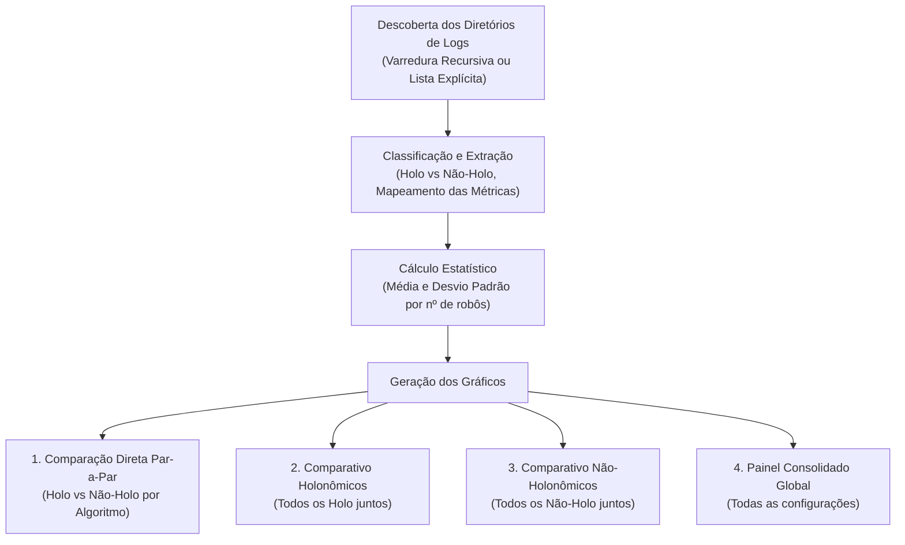

# Documentação: Geração de Gráficos Comparativos

Este documento detalha o funcionamento e a utilização do script [`gerar_graficos_comparativos.py`](file:///home/andersoney/workspace/algoritmotcc/gerar_graficos_comparativos.py), desenvolvido para processar e comparar simulações entre múltiplos algoritmos nas configurações **Holonômico** (`drive "omni"`) e **Não-Holonômico / Diferencial** (`drive "diff"`).

---

## 1. Visão Geral da Arquitetura do Script

O script opera em 4 etapas bem definidas:



---

## 2. Estrutura dos Logs e Métricas Extraídas

Para cada pasta informada, o script busca subpastas no formato `nRobots<N>` (ex: `nRobots20`, `nRobots40`, ...) e lê os arquivos de resultados individuais `logs_<exp>`.

Conforme gerado pelo `FinalLog::saveLog()` do simulador:
* **Linha 2**: `numMaxIterationsTotal` = Máximo de iterações para alcance e saída do alvo.
* **Linha 8**: `numTotalStalls` = Total de travamentos / colisões registradas.
* **Linha 9**: `reachingTargetTime` = Tempo de simulação no Stage em microssegundos ($\mu\text{s}$), convertido automaticamente para **segundos** ($t / 10^6$).

---

## 3. Tipos de Gráficos Gerados

Para cada grupo de comparação, o script gera automaticamente:
1. **Total de Stalls**: Avalia a segurança e taxa de colisões conforme a densidade de robôs aumenta.
2. **Tempo de Simulação (s)**: Avalia a eficiência temporal do algoritmo para esvaziamento/conclusão da tarefa.
3. **Máximo de Iterações**: Mede a quantidade de passos de controle necessários.
4. **Painel Consolidado (`painel_combinado.png` / `.pdf`)**: Painel 3 em 1 com todas as métricas lado a lado com barras de erro (desvio padrão $\pm \sigma$).

---

## 4. Como Executar

### Pré-requisitos
Certifique-se de que o Python possui `matplotlib` e `numpy`:
```bash
pip install matplotlib numpy
```

---

### Modo 1: Varredura Automática da pasta `/home/andersoney/workspace/Logs`
Se você colocar as pastas dentro de `/home/andersoney/workspace/Logs` (com subpastas como `PCCEEV2_holo`, `PCCEEV2_diff`, etc.), basta rodar:

```bash
python3 gerar_graficos_comparativos.py
```
*(O script detecta recursivamente todas as pastas com resultados e classifica automaticamente quem é holonômico baseado no nome da pasta).*

Você também pode apontar outra pasta raiz com `-r`:
```bash
python3 gerar_graficos_comparativos.py -r /caminho/para/meus/logs
```

---

### Modo 2: Comparação Explícita de Pastas Específicas
Você pode passar diretamente os caminhos das pastas que deseja comparar usando `-p` ou `--pastas`:

```bash
python3 gerar_graficos_comparativos.py -p saida_v2 saida_v2_holo
```

Ou comparando múltiplos algoritmos de uma só vez:
```bash
python3 gerar_graficos_comparativos.py -p /home/andersoney/workspace/Logs/Algo1 /home/andersoney/workspace/Logs/Algo1_holo /home/andersoney/workspace/Logs/Algo2 /home/andersoney/workspace/Logs/Algo2_holo
```

---

### Modo 3: Definir a pasta de saída dos gráficos
Por padrão, os gráficos são salvos em `./graficos_comparativos/`. Você pode escolher onde salvar com `-o`:

```bash
python3 gerar_graficos_comparativos.py -r /home/andersoney/workspace/Logs -o ./meus_graficos_artigo
```

---

## 5. Organização dos Arquivos de Saída

Na pasta de saída (`graficos_comparativos/`), a seguinte árvore será gerada:

```text
graficos_comparativos/
├── comparacao_algoritmos_interna/       # Comparações diretas (Holo vs Diferencial para cada algoritmo)
│   └── <nome_algoritmo>/
│       ├── <algo>_stalls.png / .pdf
│       ├── <algo>_tempo_simulacao.png / .pdf
│       ├── <algo>_iteracoes.png / .pdf
│       └── <algo>_painel_combinado.png / .pdf
├── comparativo_geral_holonomicos/       # Compara todos os algoritmos Holonômicos entre si
│   ├── holo_stalls.png / .pdf
│   ├── holo_tempo_simulacao.png / .pdf
│   └── holo_painel_combinado.png / .pdf
├── comparativo_geral_nao_holonomicos/   # Compara todos os algoritmos Não-Holonômicos entre si
│   ├── nao_holo_stalls.png / .pdf
│   └── nao_holo_painel_combinado.png / .pdf
└── comparativo_global_todos/            # Painel com todas as curvas juntas
    ├── todos_stalls.png / .pdf
    └── todos_painel_combinado.png / .pdf
```

